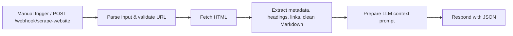

# Website Data Scraper (n8n)

Give it a URL, get back clean Markdown, plain text, page metadata and a prompt ready for an LLM.
No paid scraping APIs: it runs on n8n's built-in HTTP and Code nodes.



## What you get

- **Metadata:** title, description, keywords, author, language, canonical URL, OpenGraph and Twitter Card tags.
- **Content:** scripts, styles, navigation, headers and footers removed; the rest converted to Markdown and plain text.
- **Structure:** H1–H6 outline and links split into internal and external.
- **Stats:** word count, character count, reading time.
- **LLM prompt:** the extracted page wrapped in a research/summary prompt.

## Setup

1. In n8n: **Workflows → Import from file** → [`Website_Data_Scraper.json`](Website_Data_Scraper.json).
2. No credentials needed.
3. Click **Test workflow** (scrapes the Wikipedia "Web scraping" page), or activate it and call the webhook:

```bash
curl -X POST https://<your-n8n>/webhook/scrape-website \
  -H "Content-Type: application/json" \
  -d '{"url": "https://example.com", "selector": "article", "includeLinks": true, "includeImages": false}'
```

| Field | Meaning | Default |
| :--- | :--- | :--- |
| `url` | Page to scrape | demo page |
| `selector` | Optional CSS-like container to focus on | whole page |
| `includeLinks` / `includeImages` | Include link and image lists in the output | `true` / `false` |

## Optional: standalone Python CLI

[`scraper.py`](scraper.py) uses only the Python standard library:

```bash
python scraper.py --url "https://example.com" --format markdown --output article.md
python scraper.py --serve --port 8765   # GET /scrape?url=...
```

Tests: `python test_scraper.py` (7 tests).

## Limitations

- Pages rendered only by JavaScript (single-page apps) return little content; use a headless browser for those.
- Respect each site's terms of service and `robots.txt`.

## Status

Verified on 2026-10-27 on a self-hosted n8n (full run on the demo page) and all 7 Python tests passing.

## License

MIT, see [LICENSE](LICENSE). Built by [CyberResonance](https://cyberresonance.io).
